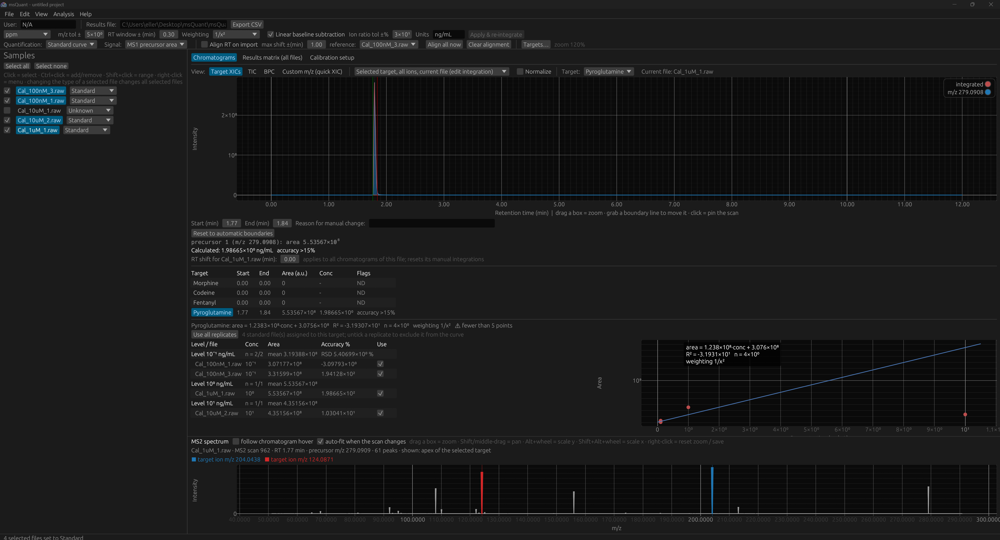

# msQuant


Desktop app (Windows, macOS) for **targeted quantification of LC-MS/MS data** from Thermo `.raw` and mzML files.
Repository: <https://github.com/markellerhorst/msQuant>

You provide a target table (name, retention time or `n/a`, diagnostic MS2 product ions, optionally the MS1 precursor m/z); the program extracts the
chromatograms, integrates the peaks (boundaries adjustable by hand, values update live) and reports either **integrated areas
(arbitrary units)** or **concentrations from per-target standard curves** measured in the same project.

> Intended for method development, research and routine targeted analysis. The software provides data-integrity
> features (hash-chained audit trail, file hashes, reasons for manual changes) but is **not validated or certified** for
> GxP / 21 CFR Part 11 use. Validation of the software and of the converter version is the user's responsibility.

## Features



- Import of Thermo `.raw` (via ThermoRawFileParser) and **mzML** files (any vendor, e.g. converted with ProteoWizard msconvert); data is kept **in memory only**
- Target table: load, edit live inside the program, save under any name; optional MS1 precursor per target (`p:286.1438`)
- Quantify on the **MS2 product-ion area** or the **MS1 precursor area**; manual integration by dragging boundaries; baseline subtraction; ion-ratio checks
- **Several targets in one project**: each target has its own calibration; standards carry a concentration *per target*; replicates share a level,
  are all used by default and can be excluded one by one; levels show n, mean area and RSD. Batch assignment of selected replicate files.
- Areas-only mode, results matrix for all files, retention-time alignment (TIC cross-correlation), TIC / BPC / XIC views of one or many files
- **Quick XIC** for any m/z (MS1 or MS2) without defining a target; "Add as target" makes it permanent
- Hover read-out on chromatograms (m/z, RT, scan, precursor m/z, intensity) and a linked **MS2 spectrum panel**; the cursor snaps to the nearest peak (RT + m/z)
- Explorer-style multi-select (Ctrl / Shift), right-click to remove a file from the project (never deletes it on disk)
- Natural zoom: drag a box around a peak to zoom to it (chromatograms and MS2 spectra), Shift/middle-drag pans, **Alt+wheel** scales the y axis and
  **Shift+Alt+wheel** the x axis, right-click → *Reset zoom*; integration boundaries are moved by grabbing the start/end line itself.
  Hover read-outs and zoom gestures only react while the pointer is inside the plot area
- The calibration curve (points, excluded points, fit) can be saved as PNG / SVG; the regression formula and R² are drawn inside the plot
- Right-click any chromatogram or MS2 spectrum → save as **PNG**, **SVG** (spectra carry the m/z of the 10 strongest peaks) or a **two-column CSV** (RT/Intensity, m/z/Intensity); file names say what is exported (TIC, BPC, XIC, MS2 scan)
- Projects (`.quant`) that **contain the raw files** (optional), undo/redo (10 steps), zoom with Ctrl +/-/0, user name in the audit trail
- Numbers in scientific notation (`10²`), except retention times (`7.20` min) and m/z values (`286.1438`); normalised views show 0–100 %

## Build
Requirements: [Rust](https://rustup.rs) (stable); on Windows additionally the *Visual Studio Build Tools* with the
"Desktop development with C++" workload; on macOS the Xcode command-line tools.

```powershell
git clone https://github.com/markellerhorst/msQuant
cd msQuant
cargo run --release          # or: cargo build --release  -> target/release/msQuant(.exe)
```

### Thermo reader (only for `.raw` files)
1. Download a release of [ThermoRawFileParser](https://github.com/CompOmics/ThermoRawFileParser/releases) and unzip it to
   `tools/ThermoRawFileParser<anything>/` (searched automatically) or point to it under **Edit → Preferences**.
2. The framework-dependent builds need the **.NET 8 runtime**; the self-contained builds do not.
   Preferences → *Test* runs `ThermoRawFileParser -v`.

## Use
1. Drop a target table `.csv` and `.raw` / `.mzML` files onto the window (or use the File menu). Table format: `name,rt_min,ions` – `n/a` for an unknown RT,
   MS2 product ions separated by `;` (the first is the quantifier) and, optionally, the MS1 precursor as `p:286.1438`, e.g.
   `Morphine,n/a,286.14;201.07;165.05;p:286.1438`.
2. **Calibration setup** tab: select the replicate files of one level (Ctrl/Shift+click in the sample list), choose the target and the concentration,
   press *Assign as standards*; repeat for every level and target. Only files of type *Standard* are listed in the matrix below; it allows per-cell edits.
   Setting the type (Standard, Unknown, QC, Blank) of a file that is part of a multi-selection sets **all selected files** to that type.
3. Choose the signal (MS2 product ions or MS1 precursor) in the top bar. Check/adjust the integrated peaks; give a reason for manual changes.
   Replicates can be excluded from a curve with the checkbox in the calibration table.
4. Export the results (`Export CSV`), save the project (`Ctrl+S`). A project embeds the original files, so it can be opened on another PC
   (ThermoRawFileParser is needed there for `.raw`). While opening, each embedded `.raw` is copied to a temporary file for the converter and deleted again
   immediately; the data itself stays in memory. Untick *Embed raw files when saving projects* to save only references + SHA-256.

## Where msQuant stores files
Nothing is written during normal use except three things, all in the folder `msQuant-default` in the root folder of the installation
(created if necessary; with `cargo run` that is the project folder):

| File | Content |
|---|---|
| `msQuant-default/settings.txt` | user settings (converter location, user name, zoom, standard folder, project options) |
| `msQuant-default/audit_trail.log` | the hash-chained audit trail |
| `msQuant-default/tmp/` | temporary files (a raw file extracted from a project, files of the converter); emptied at every start |

Files you create yourself (projects, results, figures, CSV exports, target tables) are offered in a **standard folder**, which is `msQuant-default` unless you
choose another one under *Edit → Preferences → Folders*. Every file dialog starts there; you can always pick a different location in the dialog.

## How quantification works

**Signal (top bar → "Signal")** decides which chromatogram of a target is integrated. Retention times are first shifted by the alignment (if used).

| | **MS2 product-ion mode** (default) | **MS1 precursor mode** |
|---|---|---|
| Traces per target | one extracted-ion chromatogram (XIC) for every listed product ion | one XIC for the precursor m/z (`p:` in the target table) |
| Scans used | all MS2 scans (the precursor that was fragmented is shown but *not* used as a filter) | all MS1 scans |
| XIC point | per scan: sum of the intensities of all peaks within ±m/z tolerance (ppm or Da) of the m/z | same |
| Quantifier | the **first** product ion; the others are qualifiers | the precursor trace |
| Ion-ratio check | qualifier area / quantifier area compared with the mean ratio of the included standards (±tolerance, default 30 %) → flag *ionN ratio fail* | not applicable |
| Missing precursor | – | target gets no peak (ND); add `p:<m/z>` to the table |

**Peak detection and integration** (identical in both modes)
Peak Detection and Integration

msQuant currently uses apex-based peak detection: the highest intensity within an optional retention-time window defines the peak apex. Boundaries are determined by searching left and right until the signal falls below 5% of apex intensity or two consecutive rising points indicate a boundary. Peak area is calculated using trapezoidal integration:

$$
A = \sum_{i=1}^{n-1} \frac{I_i + I_{i+1}}{2}(t_{i+1}-t_i)
$$

Linear baseline correction is supported. Users can manually adjust integration boundaries through the GUI. Advantages: Simple, fast, and reproducible. Limitations: Fixed thresholds can be unreliable for noisy baselines, tailing peaks, and overlapping peaks.

**Calibration** (mode *Standard curve*; one calibration per target and per signal)
- Standards are files of type *Standard* that carry a concentration > 0 for that target. A file can be a standard for several targets with different concentrations; replicates are files with the same concentration.
- Points are (concentration, quantifier area). All replicates are used by default; any replicate can be excluded in the calibration table (the curve updates at once).
  At least two different levels are needed.
- Fit: area = slope · concentration + intercept (not forced through zero), weighted least squares with weights 1, 1/x or 1/x² (x = concentration). R² is calculated unweighted.
- Result for a sample: concentration = (area − intercept) / slope. Flags: *ND* (no peak), *outside cal range* (below the lowest / above the highest included standard), *PEAK IN BLANK*,
  *accuracy >15 %* (back-calculated standards), *manual* (hand-set boundaries).
- Switching between MS2 and MS1 keeps the standard assignments but refits every calibration from the other signal's areas. In *Areas only* mode no calibration is used and areas are reported in arbitrary units.

## Project file size
A `.quant` project that embeds its raw files is as large as the raw files together (often several GB). Saving runs in the background and
streams the data. Projects from older versions can still be opened.

## Memory note
MS1 spectra are kept in memory (needed for MS1-based quantification), so each imported file needs roughly 50–300 MB depending on scan count and peak density.
Remove files you no longer need (right-click → Remove from project).

## Test
```powershell
cargo test --no-fail-fast       # unit tests + synthetic-data tests (+ real files from test-data/)
cargo test -- --nocapture       # also shows which tests were skipped
```
Tests that use real files read them from `test-data/` (`*.raw`, optional `*.csv` target tables and `*.quant` projects). They are
skipped when the files or ThermoRawFileParser are missing. Raw files are large and are not committed (see `.gitignore`).

## Code style
The code follows the [Google Rust Style Guide](https://google.github.io/styleguide/rustguide.html) (part of the
[Google Style Guides](https://google.github.io/styleguide/)): documentation comments (`///`, `//!`) for every module and item, one `use` per module,
module-qualified calls of free functions, no glob imports and no `unwrap` in library code. Formatting is `rustfmt` with 100 columns (`rustfmt.toml`); run `cargo fmt` before committing.

## Credits and licenses
- Built with **Claude Sonnet 5.5 (Medium)** (Anthropic); the **app icon was generated with Gemini** (Google).
- Thermo `.raw` reading: [ThermoRawFileParser](https://github.com/CompOmics/ThermoRawFileParser) (Apache-2.0), which uses Thermo Fisher Scientific's
  RawFileReader library under Thermo's license. Hulstaert et al., *J Proteome Res* 2020, 19, 537–542, doi:10.1021/acs.jproteome.9b00328.
- GUI: egui / eframe / egui_plot, file dialogs: rfd. See [THIRD_PARTY_NOTICES.md](THIRD_PARTY_NOTICES.md).
- This project is released under the [MIT License](LICENSE).
